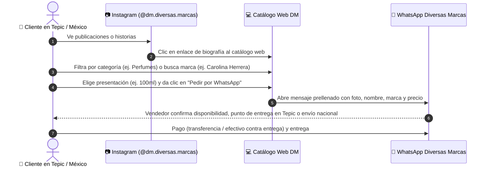

# 🏷️ Diversas Marcas — Manual de Identidad de Marca y Análisis Estratégico

> **Ubicación**: Tepic, Nayarit, México  
> **Instagram Oficial**: [@dm.diversas.marcas](https://www.instagram.com/dm.diversas.marcas/) (Diversas Marcas)  
> **WhatsApp de Atención**: +52 311 191 2342  
> **Líneas de Negocio**: Ropa, Calzado, Perfumes y Accesorios de marcas reconocidas  

---

## 1. Visión General del Negocio
**Diversas Marcas (DM)** es una boutique multimarca con sede en **Tepic, Nayarit**, especializada en la venta de **ropa, calzado urbano y deportivo, fragancias de diseñador y accesorios de marcas internacionales reconocidas** (Carolina Herrera, Dior, Paco Rabanne, Versace, Nike, Adidas, Tommy Hilfiger, Levi's, Calvin Klein, Ray-Ban, entre otras).

Su propuesta se basa en ofrecer **productos 100% originales**, con disponibilidad inmediata para entregas personales en Tepic y envíos a todo México, brindando un servicio ágil y cercano mediante catálogo web y atención por WhatsApp y DM de Instagram.

---

## 2. Plataforma de Marca

### 🎯 Propuesta de Valor Única (UVP)
> *"Tus marcas favoritas en un solo lugar: estilo, calidad y comodidad con entregas en Tepic y envíos a todo México."*

### 🧭 Misión
Ofrecer a nuestra comunidad en Tepic y en todo el país prendas, calzado, accesorios y perfumes originales de las firmas más deseadas a precios justos, con un trato cálido, transparente y sin complicaciones.

### 🔭 Visión
Consolidarse como la tienda multimarca preferida de moda urbana, calzado y perfumería en Nayarit y un referente de confianza en e-commerce y venta social en México.

### 💎 Pilares de Marca
1. **Autenticidad 100%**: Cada fragancia, tenis o prenda cuenta con garantía de originalidad, sellos y batch codes verificables.
2. **Variedad en Tendencia**: Catálogo diverso que combina lo mejor del streetwear deportivo con la sofisticación de la perfumería fina.
3. **Cercanía Local (Orgullo Tepic)**: Entregas directas, facilidad de apartado y asesoría personalizada en Nayarit.
4. **Precios Accesibles**: Oportunidades y descuentos que hacen accesible el lujo y la moda de marca.

---

## 3. Identidad Verbal y Tono de Comunicación

### 🗣️ Tono de Voz
* **Cercano, juvenil y servicial**: Como una recomendación de un amigo que conoce las mejores marcas y ofertas.
* **Seguro y resolutivo**: Respuestas rápidas en WhatsApp sobre tallas, disponibilidad, mililitros de perfumes y métodos de pago.
* **Dinámico en promociones**: Uso de llamados a la acción claros: *"¡Aparta tu talla hoy!", "¡Últimas piezas disponibles!", "¡Llegaron nuevos perfumes!"*.

### ✍️ Eslogans y Frases Clave
* **Slogan Principal**: *"Ropa, calzado, perfumes y accesorios de tus marcas favoritas."*
* **Slogan Secundario**: *"Estilo, calidad y comodidad en Tepic."*
* **Llamado de Conversión**: *"¿Te gustó? Pídelo al instante por WhatsApp o DM."*

---

## 4. Identidad Visual y Análisis del Logotipo

El logotipo de **Diversas Marcas** sintetiza perfectamente la esencia del negocio:

1. **Monograma Central "DM"**:
   - Tipografía serif elegante, robusta y con carácter.
   - Refleja seriedad y respaldo de marcas de prestigio.
2. **Iconos Integrados**:
   - **Playera colgada (Adidas)**: Representa el segmento textil y deportivo.
   - **Gorra deportiva (Nike)**: Representa el estilo urbano y accesorios.
   - **Lentes Wayfarer (Ray-Ban) con swoosh dinámico**: Representa la protección, el diseño y el estilo casual contemporáneo.
   - **Perfumes (Incorporación conceptual)**: Complementa la experiencia sensorial y de cuidado personal.
3. **Colores de la Marca**:
   - **Negro Carbón (`#111827` / `#000000`)**: Solidez, elegancia atemporal, contraste.
   - **Marfil / Crema Cálido (`#FBF8F3` / `#F4EFE6`)**: Calidez, distinción, fondo suave y limpio.
   - **Dorado Ámbar (`#D97706`)**: Acento de lujo, perfumería fina y badges de "OFERTA".
   - **Verde WhatsApp (`#25D366`)**: Llamado a la acción rápido e intuitivo para cotizaciones.

---

## 5. Análisis del Mercado en Tepic y Estrategia Comercial (DOFA)

| Factor | Análisis Estratégico |
| :--- | :--- |
| **Fortalezas** | • Logo ya reconocido en Instagram (@dm.diversas.marcas). • Catálogo multimarca integral (Ropa + Tenis + Perfumes + Accesorios). • Entregas locales rápidas en Tepic y atención inmediata por WhatsApp. |
| **Oportunidades** | • Gran mercado de jóvenes y adultos en Nayarit que buscan marcas originales sin tener que pagar sobreprecios en centros comerciales departamentales. • El segmento de perfumes tiene alta rotación y recompra continua (regalos, cumpleaños, fechas especiales). • Catálogo web interactivo que ahorra tiempo de respuesta al enviar la cotización con talla y foto lista. |
| **Debilidades** | • Canal de venta actualmente muy dependiente del chat directo. • Necesidad de educar al cliente sobre la originalidad frente a imitaciones informales. |
| **Amenazas** | • Proliferación de clones y piratería en tianguis o redes sociales con precios artificialmente bajos. *Estrategia contra-amenaza*: Enfatizar fotos reales, batch codes en perfumes y garantía de satisfacción. |

---

## 6. Embudo de Venta Optimizado (Instagram / Web ➡️ WhatsApp)

